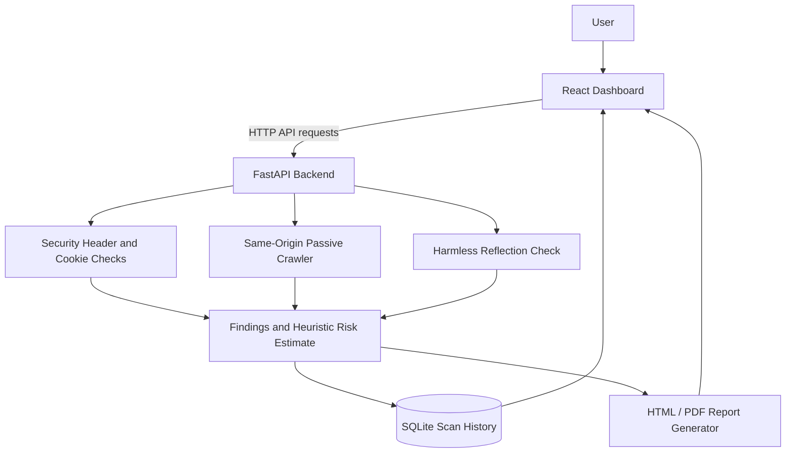

::: {align="center"}
# 🛡️ WebSentinel

### Local-first Web Security Scanner

**Inspect security headers. Crawl linked pages. Review findings. Export
reports.**

[](https://www.python.org/)
[](https://fastapi.tiangolo.com/)
[](https://react.dev/)
[](https://sqlite.org/)

*A learning-focused web security assessment project built with React,
FastAPI, Python, and SQLite.*

[Features](#-features) · [Architecture](#-architecture) ·
[Screenshots](#-screenshots) · [Getting Started](#-getting-started) ·
[Responsible Use](#-responsible-use)
:::

------------------------------------------------------------------------

## ✨ Overview

WebSentinel is a web-based tool for performing **basic, low-impact
security checks** against web applications you own or are explicitly
authorized to assess. It brings selected HTTP security-header checks,
cookie observations, basic same-origin crawling, a safe reflection
check, scan history, and report exports into one interface.

It is a learning and portfolio project---not a replacement for a
professional penetration test or a full-featured commercial scanner.

## 🚀 Features

  -----------------------------------------------------------------------
  Feature                             What it does
  ----------------------------------- -----------------------------------
  **Security-header checks**          Reports selected HTTP security
                                      headers that are present or
                                      missing.

  **CSP observations**                Provides basic observations about
                                      Content Security Policy
                                      configuration.

  **Cookie observations**             Reviews `Secure`, `HttpOnly`, and
                                      `SameSite` attributes when
                                      available.

  **Website crawler**                 Follows eligible same-origin HTML
                                      links and performs basic passive
                                      checks within configured limits.

  **Safe reflection check**           Sends a harmless canary value and
                                      checks whether it appears in a
                                      response; it does not execute
                                      JavaScript payloads.

  **Risk estimate**                   Calculates a heuristic score from
                                      selected findings. This is not a
                                      validated risk rating.

  **Scan history**                    Stores normal scan results locally
                                      in SQLite.

  **Scan comparison**                 Compares saved scan results.

  **Reports**                         Exports scan results to HTML and
                                      PDF formats.

  **Authentication UI**               Includes sign-up, login, and
                                      password-recovery flows. Review the
                                      security notes before exposing the
                                      application publicly.
  -----------------------------------------------------------------------

## 🧭 Architecture



### Main components

-   **Frontend:** React interface for submitting scans and reviewing
    results.
-   **Backend:** FastAPI application that validates targets, performs
    checks, and returns findings.
-   **Persistence:** SQLite database for normal scan history.
-   **Reporting:** HTML and PDF exports generated from saved scan
    results.

## 🖼️ Screenshots

Add real screenshots from your running application to
`docs/screenshots/` using these filenames. The image links below will
display them once the files are committed.

``` text
docs/
└── screenshots/
    ├── dashboard.png
    ├── scan-results.png
    ├── crawler.png
    └── report-preview.png
```

```{=html}
<details>
```
```{=html}
<summary>
```
`<strong>`{=html}Dashboard`</strong>`{=html} ---
`<code>`{=html}docs/screenshots/dashboard.png`</code>`{=html}
```{=html}
</summary>
```


```{=html}
</details>
```
```{=html}
<details>
```
```{=html}
<summary>
```
`<strong>`{=html}Scan results`</strong>`{=html} ---
`<code>`{=html}docs/screenshots/scan-results.png`</code>`{=html}
```{=html}
</summary>
```


```{=html}
</details>
```
```{=html}
<details>
```
```{=html}
<summary>
```
`<strong>`{=html}Crawler`</strong>`{=html} ---
`<code>`{=html}docs/screenshots/crawler.png`</code>`{=html}
```{=html}
</summary>
```


```{=html}
</details>
```
```{=html}
<details>
```
```{=html}
<summary>
```
`<strong>`{=html}Report preview`</strong>`{=html} ---
`<code>`{=html}docs/screenshots/report-preview.png`</code>`{=html}
```{=html}
</summary>
```


```{=html}
</details>
```
> Use genuine screenshots. Hide personal information, reset links,
> tokens, email addresses, and anything private before committing them.

## 🧰 Technology Stack

-   **Frontend:** React, Vite, JavaScript, CSS
-   **Backend:** Python, FastAPI, Uvicorn
-   **HTTP requests:** Requests
-   **HTML parsing:** Beautiful Soup
-   **Database:** SQLite
-   **PDF reporting:** ReportLab
-   **Practice target:** OWASP Juice Shop (optional)

## 🏁 Getting Started (Windows)

### Prerequisites

Install [Python](https://www.python.org/downloads/), [Node.js
LTS](https://nodejs.org/), and [Git](https://git-scm.com/downloads).
[Docker Desktop](https://www.docker.com/products/docker-desktop/) is
optional for running OWASP Juice Shop locally.

### 1. Clone the repository

``` powershell
git clone https://github.com/27omkar/WebSentinel.git
cd WebSentinel
```

### 2. Set up the backend

From the project root:

``` powershell
python -m venv backend\.venv
backend\.venv\Scripts\python.exe -m pip install --upgrade pip
backend\.venv\Scripts\python.exe -m pip install fastapi uvicorn requests beautifulsoup4 reportlab
```

Start the backend:

``` powershell
backend\.venv\Scripts\python.exe -m uvicorn main:app --app-dir backend --host 127.0.0.1 --port 8002
```

API documentation: http://127.0.0.1:8002/docs

### 3. Set up the frontend

Open a **second terminal** in the project root:

``` powershell
cd frontend
npm install
npm run dev
```

Open the local URL printed by Vite, usually http://localhost:5173. Keep
both terminals running.

### 4. Optional: run OWASP Juice Shop locally

If Docker Desktop is installed and running:

``` powershell
docker run --rm -p 127.0.0.1:3000:3000 bkimminich/juice-shop
```

Use this target in WebSentinel:

``` text
http://127.0.0.1:3000
```

Only scan systems you own or have explicit permission to assess.

## 🔍 How to Use

1.  Start the backend and frontend.
2.  Open the dashboard in your browser.
3.  Enter a permitted target URL.
4.  Run a normal scan and review its evidence and findings.
5.  Use the crawler or harmless reflection check when appropriate.
6.  Review scan history and compare saved scans.
7.  Export a report for documentation.

## 📊 Understanding Results

-   **Present** means the checked header was observed in the response.
-   **Missing** means the expected header was not observed in that
    response.
-   **Not assessed / informational** means a check may not apply or its
    result is informational.
-   **Risk score** is a project-specific heuristic. It is not CVSS and
    is not a validated measure of exploitability.

A missing header is not proof that a website is compromised. Interpret
findings in context and verify important results independently.

## ⚠️ Current Scope and Limitations

-   WebSentinel does **not** provide complete OWASP Top 10 coverage.
-   It does **not** implement dedicated SQL injection testing.
-   A reflected canary value does **not** prove exploitable XSS.
-   The basic crawler may miss JavaScript-generated links, authenticated
    pages, forms, and routes not linked in eligible HTML.
-   A scan covers only the responses and pages the tool actually
    reaches.
-   Risk scores are heuristic and should not be treated as a formal
    security rating.
-   Reports depend on the scan data saved by the application.

## 🔐 Security and Responsible Use

-   Scan only applications you own or have explicit authorization to
    test.
-   Prefer a local training target such as OWASP Juice Shop when
    learning.
-   Never commit `.env` files, credentials, reset tokens, local
    databases, virtual environments, or private data.
-   Before deploying beyond localhost, review authentication, session
    handling, password-reset delivery, rate limiting, HTTPS, CORS,
    secret management, and target-validation safeguards.
-   A development password-reset link shown locally is not the same as
    production email-based recovery.
-   Do not expose a development instance to the public internet without
    a security review.

## 🗺️ Roadmap

-   [ ] Add more safe, evidence-based security checks
-   [ ] Improve crawler visibility and per-page results
-   [ ] Add clearer remediation guidance for each finding
-   [ ] Improve report visuals and scan-comparison charts
-   [ ] Add automated tests for backend validation and scan behavior
-   [ ] Harden authentication and password recovery for production
    deployment

## 🤝 Contributing

Suggestions and improvements are welcome. For substantial changes, open
an issue first to describe the proposed feature or fix. Keep testing
safe and authorized.

## 📄 License

No license is specified yet. Add a `LICENSE` file before describing this
project as open source. Choose a license that matches how you want
others to use, modify, and distribute the code.

------------------------------------------------------------------------

::: {align="center"}
**Built as a hands-on web security learning project.**

⭐ If you find WebSentinel useful, consider starring the repository.
:::
